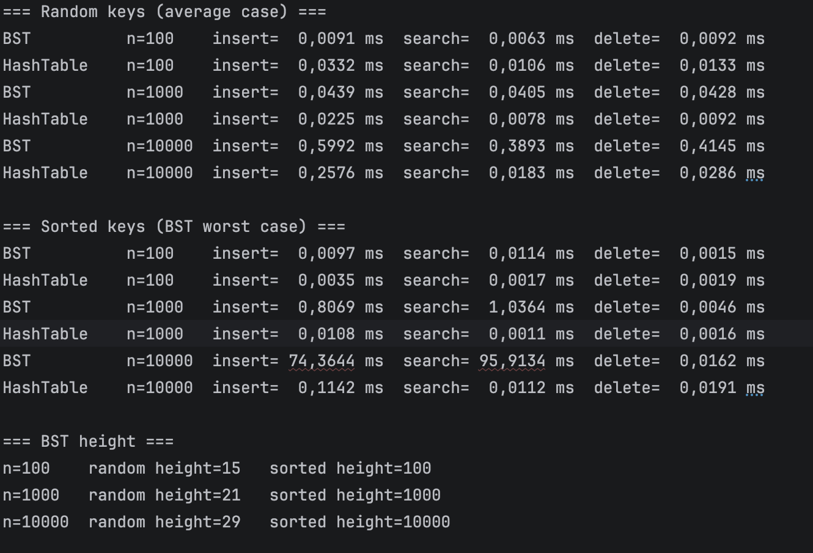

# BST vs Hash Table

 Files and how to run

The repository has BST.java (Binary Search Tree with insert, search and delete), HashTable.java (Hash Table with separate chaining), Tests.java (simple correctness tests), Benchmark.java (measures execution time) and results.txt (output of the benchmark). To run the project, compile with javac *.java, then run java Tests, then run java Benchmark. The benchmark writes its output to results.txt automatically.

## 1. Implementation

BST. Every node has a key, a left child and a right child. Smaller keys go left and bigger keys go right. Insert, search and delete follow one path from the root down. Delete has three cases: a leaf, a node with one child, and a node with two children, which is replaced by the smallest key of the right subtree.

Hash Table. It is an array of buckets. A hash function turns a key into an array index. If two keys land in the same bucket, they are stored in a linked list (separate chaining). When the table is more than 75% full, the array size is doubled and all keys are placed again with the hash function.

## 2. Time complexity

BST: insert, search and delete all have the same complexity. The best case is O(1), when the key is at the root. The average case is O(log n), when the tree is balanced. The worst case is O(n), when the tree is a line.

Hash Table: insert, search and delete all have the same complexity. The best case is O(1), when the key is alone in its bucket. The average case is O(1), when keys are spread evenly. The worst case is O(n), when all keys fall into the same bucket.

Why: for the BST, the time depends on the height of the tree. If keys come in random order, the tree is balanced and the height is about log n. If keys come already sorted, the tree becomes a line, like a linked list, with height n, so the worst case is O(n).

For the Hash Table, a good hash function spreads keys evenly, so each bucket has very few keys and operations take O(1). If many keys fall into the same bucket, we must walk a long list, so the worst case is O(n).

## 3. Experiment

Both structures were tested with 100, 1,000 and 10,000 elements. Each test inserts all keys, searches all keys, then deletes all keys. Times are averages over 20 runs after warm-up, in milliseconds. Each time is the total for all n operations.

With random keys, the hash table was faster at n = 1,000 and n = 10,000. At n = 10,000 its search took about 0.018 ms and the BST search about 0.389 ms, so the hash table was roughly 20 times faster. When n grew 10 times, from 1,000 to 10,000, the total BST time grew about 10 to 14 times, which is the n log n growth. Hash table search time grew only about 2 times, so it scales better. The exact numbers are noisy because the times are very small. At n = 100 with random keys the BST was faster than the hash table for all three operations. The times are tiny there, so the difference is probably noise and the cost of resizing the hash table.

With sorted keys the BST became very slow. At n = 10,000 insert took 74 ms and search took 96 ms, because the height of the tree was 10,000, so it was a line. The hash table stayed at about 0.1 ms or less. BST delete was very fast with sorted keys. This is because the keys were deleted in the same sorted order, so each deleted key was the root with only a right child, which takes O(1). This is not typical, it is a special case of our test.

## 4. Why performance differs in practice

The hash table jumps directly to the right bucket, so its time almost does not grow with n. The BST has to walk down the tree, so its time grows with the height. A BST is only fast if it is balanced. With sorted input it becomes a line and gets very slow, while a hash table does not care about the order of the keys.

A hash table needs extra work for hashing and sometimes for resizing, and a bad hash function causes many collisions. A BST keeps keys in order, so it can do things a hash table cannot do easily, like printing keys sorted or finding the smallest key. Small inputs such as n = 100 are so fast that the difference is tiny and the measurement is noisy.

## 5. Conclusion

For simple insert, search and delete, the hash table is usually faster. The BST is a good choice when the order of keys matters, but it can become slow if it is not balanced. The results of the experiment match the theory: the hash table stays almost constant, and the BST grows slowly with random keys and very fast with sorted keys.